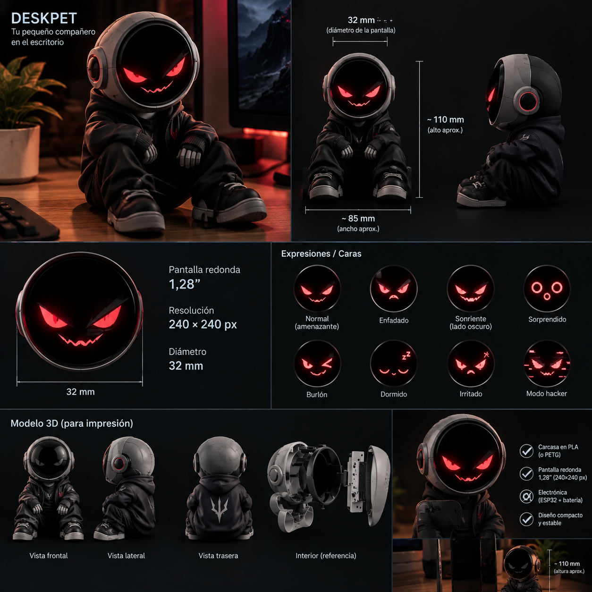
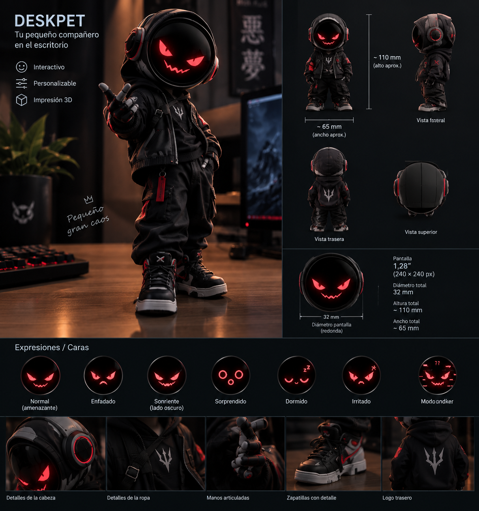

# DeskPet · Robot de escritorio

> 🚧 **En desarrollo.** Proyecto en fase inicial: todavía no hay hardware funcionando. El avance se sigue en los [issues](../../issues) y en las [fases](#fases).

Un **robot de escritorio con ojos animados** que reacciona a lo que le haces: parpadea, mira a los lados, se pone contento si lo acaricias, se sorprende si le das un toque, se marea si lo sacudes y protesta si lo pones boca abajo.

Inspirado en robots comerciales como Eilik o EMO, pero hecho desde cero con una ESP32-C3 y componentes de menos de 10 €.

## Diseño

Así es como quiero que quede: un muñeco de unos 110 mm con casco, cuya cara es la pantalla redonda de 1,28" (32 mm).

<p>
  
  
</p>

## Cómo funciona (previsto)

```
┌───────────────┐                          ┌──────────────────┐                        ┌────────────────┐
│ Sensor táctil │ ── caricia / toque ────▶ │                  │ ── dibuja los ojos ──▶ │ Pantalla 1,28" │
│    TTP223     │                          │    ESP32-C3      │                        └────────────────┘
└───────────────┘                          │  (máquina de     │
┌───────────────┐                          │   estados de     │                        ┌────────────────┐
│    MPU6050    │ ── golpe / sacudida / ─▶ │   emociones)     │ ── sonidos (opc.) ───▶ │  MAX98357A +   │
│ (acelerómetro)│    boca abajo / alzado   │                  │                        │  microaltavoz  │
└───────────────┘                          └──────────────────┘                        └────────────────┘
```

1. **Sensores**: el táctil detecta caricias (incluso a través de la carcasa) y el acelerómetro detecta golpes, sacudidas, inclinación y que lo levanten.
2. **Emociones**: una máquina de estados decide cómo se siente el robot (tranquilo, contento, sorprendido, enfadado, mareado, aburrido, dormido) según lo que pase y el tiempo sin interacción.
3. **Ojos**: cada emoción tiene su animación en la pantalla, con parpadeos y miradas aleatorias para que parezca vivo.
4. **Sonido** *(opcional)*: pequeños efectos para cada reacción.

## Fases

| Fase | Objetivo | Estado |
|---|---|---|
| 0 | Material y entorno | ⏳ |
| 1 | Ojos animados en la pantalla | ⬜ |
| 2 | Reacción al toque | ⬜ |
| 3 | Golpes, sacudidas y orientación | ⬜ |
| 4 | Emociones y comportamiento | ⬜ |
| 5 | Sonido | ⬜ |
| 6 | Carcasa | ⬜ |

El detalle de cada fase está en [docs/plan.md](docs/plan.md).

## Material

| Componente | Cantidad | Para qué | Precio aprox. |
|---|---|---|---|
| ESP32-C3 SuperMini (pines soldados) | 1 | El cerebro: anima los ojos y lee los sensores | 3,09 € |
| Pantalla redonda IPS 1,28" 240×240 (GC9A01) | 1 | La cara: ojos y boca | 3,29 € |
| Sensor táctil TTP223 | 1 | Detectar caricias y toques | 0,98 € |
| MPU6050 (GY-521) | 1 | Detectar golpes, sacudidas e inclinación | 1,80 € |
| Amplificador MAX98357A *(opcional)* | 1 | Sonido digital (I2S) | 0,80 € |
| Microaltavoz con caja 8 Ω *(opcional)* | 1 | Altavoz pequeño y fácil de esconder | 1,17 € |
| Cables Dupont | — | Conexiones mientras se prueba | ~1 € |

**Total:** ~9 € (~11 € con sonido). Enlaces en [docs/material.md](docs/material.md).

## Documentación

- [Plan por fases](docs/plan.md)
- [Material y enlaces](docs/material.md)
- [Conexiones](docs/conexiones.md) (borrador)
- [Emociones](docs/emociones.md) (borrador)

## Estructura

```
├── firmware/      Código de la ESP32-C3 (Arduino / PlatformIO)
├── carcasa/       Diseño 3D de la carcasa (STL y fuentes)
└── docs/          Plan, material, conexiones y emociones
```

## Tecnologías

C++ (Arduino, PlatformIO) · ESP32-C3 · SPI (pantalla) · I2C (MPU6050) · I2S (sonido) · Diseño 3D

## Autor

[Darío Domínguez García](https://github.com/DarioAlRio)
